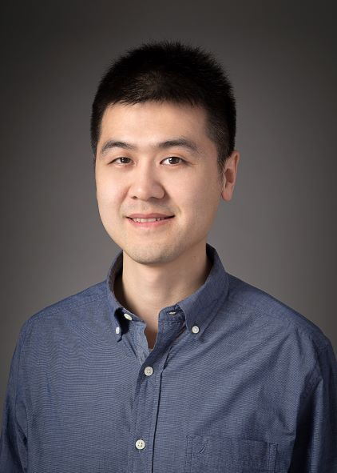
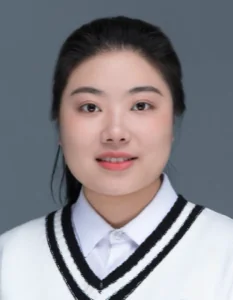
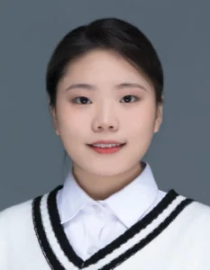
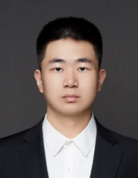
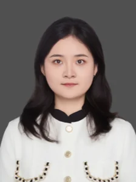
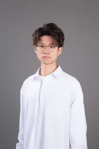
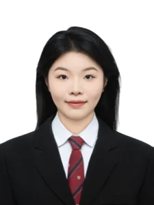
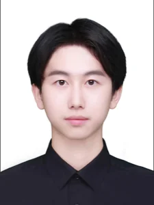

  <h2>Members (26: 1 Professor, 2 Assistant Professors, 7 Ph.D. Students, 16 M.S. Students)成员（26人：教授1人、助理教授2人、博士生7人、硕士生16人）</h2>
  <a href="#professor">Professor教授</a>
  <a href="#assistant-professor">Assistant Professor助理教授</a>
  <a href="#phd">Ph.D. Students博士生</a>
  <a href="#ms">M.S. Students硕士生</a>
  <a href="#outreach">Outreach本科生</a>
  <a href="#alumni">Alumni校友</a>

<section class="faculty-profile" id="tcheng" aria-labelledby="professor">
  <header class="faculty-profile-heading">
    <h2 id="professor">Tao Cheng (程涛)</h2>
    
Professor教授

    

      <a href="http://funsom.suda.edu.cn/funsomen/3c/0c/c3002a277516/page.htm">Institute of Functional Nano &amp; Soft Materials (FUNSOM)苏州大学功能纳米与软物质研究院（FUNSOM）</a>
      <a href="http://www.suda.edu.cn/">Soochow University苏州大学</a>
    

  </header>

  

  <dl class="faculty-profile-details">
    

      <dt>Office办公室</dt>
      <dd>912-413 (4th floor), Soochow University Dushu-Lake Campus, Box 33, 199 Ren’ai Rd, Suzhou Industrial Park, Suzhou, Jiangsu, 215123, P.R. China苏州大学独墅湖校区912-413（4楼），江苏省苏州市苏州工业园区仁爱路199号33号信箱，邮编215123</dd>
    

    

      <dt>Email邮箱</dt>
      <dd><a href="mailto:{{ site.email }}">{{ site.email }}</a></dd>
    

    

      <dt>Websites网址</dt>
      <dd>
        <ul class="faculty-profile-links" role="list">
          <li><a href="http://web.suda.edu.cn/tcheng/">Soochow University苏州大学个人主页</a></li>
          <li><a href="http://funsom.suda.edu.cn/funsomen/3c/0c/c3002a277516/page.htm">FUNSOMFUNSOM 主页</a></li>
        </ul>
      </dd>
    

    

      <dt>Early Career Advisory Board期刊青年编委</dt>
      <dd>
        <ul class="faculty-profile-links" role="list">
          <li><a href="https://onlinelibrary.wiley.com/journal/25750356">Energy &amp; Environmental Materials (EEM)</a></li>
          <li><a href="https://onlinelibrary.wiley.com/journal/2688819x">SmartMat</a></li>
          <li><a href="https://www.sciencedirect.com/journal/chinese-chemical-letters">Chinese Chemical Letters (CCL)</a></li>
          <li><a href="https://www.materialstoday.com/energy/journals/materials-today-energy/">Materials Today Energy</a></li>
        </ul>
      </dd>
    

  </dl>
</section>

<section class="faculty-history" aria-labelledby="experience工作经历">
  <h2 id="experience工作经历">Experience工作经历</h2>
  <ul role="list">
    <li>
      
<time datetime="2018-11">2018.11</time> – now至今

      

        <h3>Professor教授</h3>
        

          <a href="http://funsom.suda.edu.cn/funsomen/3c/0c/c3002a277516/page.htm">Institute of Functional Nano &amp; Soft Materials (FUNSOM)</a>, <a href="http://www.suda.edu.cn/">Soochow University</a>
          <a href="http://funsom.suda.edu.cn/funsomen/3c/0c/c3002a277516/page.htm">功能纳米与软物质研究院（FUNSOM）</a>，<a href="http://www.suda.edu.cn/">苏州大学</a>
        

      

    </li>
    <li>
      
<time datetime="2015-10">2015.10</time> – <time datetime="2018-10">2018.10</time>

      

        <h3>Research Scientist研究科学家</h3>
        

          <a href="https://solarfuelshub.org/">Joint Center for Artificial Photosynthesis</a>, <a href="http://www.caltech.edu/">Caltech</a>
          <a href="https://solarfuelshub.org/">人工光合作用联合中心（JCAP）</a>，<a href="http://www.caltech.edu/">加州理工学院</a>
        

      

    </li>
    <li>
      
<time datetime="2012-10-24">2012.10.24</time> – <time datetime="2015-10-26">2015.10.26</time>

      

        <h3>Postdoc博士后</h3>
        

          <a href="http://www.wag.caltech.edu/">Materials and Process Simulation Center</a>, <a href="http://www.caltech.edu/">Caltech</a>
          <a href="http://www.wag.caltech.edu/">材料与过程模拟中心</a>，<a href="http://www.caltech.edu/">加州理工学院</a>
        

        

          <a href="http://cce.caltech.edu/">Division of Chemistry and Chemical Engineering</a>, <a href="http://www.caltech.edu/">Caltech</a>
          <a href="http://cce.caltech.edu/">化学与化学工程系</a>，<a href="http://www.caltech.edu/">加州理工学院</a>
        

        

          with Prof. <a href="https://www.cce.caltech.edu/content/william-a-goddard">William A Goddard III</a>
          合作导师：<a href="https://www.cce.caltech.edu/content/william-a-goddard">William A Goddard III</a> 教授
        

      

    </li>
  </ul>
</section>

<section class="faculty-history" aria-labelledby="education教育经历">
  <h2 id="education教育经历">Education教育经历</h2>
  <ul role="list">
    <li>
      
<time datetime="2009-09">2009.9</time> – <time datetime="2012-09">2012.9</time>

      

        <h3>Ph.D. in Chemistry化学博士</h3>
        

          <a href="http://scce.sjtu.edu.cn/">School of Chemistry and Chemical Engineering (SCCE)</a>, <a href="https://www.sjtu.edu.cn/">Shanghai Jiao Tong University (SJTU)</a>
          <a href="http://scce.sjtu.edu.cn/">化学化工学院</a>，<a href="https://www.sjtu.edu.cn/">上海交通大学</a>
        

        

          Advisor: Prof. <a href="http://sun.sjtu.edu.cn/">Huai Sun</a>
          导师：<a href="http://sun.sjtu.edu.cn/">Huai Sun</a> 教授
        

      

    </li>
    <li>
      
<time datetime="2007-09">2007.9</time> – <time datetime="2009-06">2009.6</time>

      

        <h3>M.S. in Chemistry化学硕士</h3>
        

          <a href="http://scce.sjtu.edu.cn/">SCCE</a>, <a href="https://www.sjtu.edu.cn/">SJTU</a>
          <a href="http://scce.sjtu.edu.cn/">化学化工学院</a>，<a href="https://www.sjtu.edu.cn/">上海交通大学</a>
        

      

    </li>
    <li>
      
<time datetime="2003-09">2003.9</time> – <time datetime="2007-07">2007.7</time>

      

        <h3>B.S. in Chemistry化学学士</h3>
        

          <a href="http://scce.sjtu.edu.cn/">SCCE</a>, <a href="https://www.sjtu.edu.cn/">SJTU</a>
          <a href="http://scce.sjtu.edu.cn/">化学化工学院</a>，<a href="https://www.sjtu.edu.cn/">上海交通大学</a>
        

      

    </li>
  </ul>
</section>

<a href="#top">Back to top返回顶部</a>

---

<h2 id="assistant-professor">Assistant Professor助理教授</h2>

  
  
<a target="_blank" href="/people/hyang/">Hao Yang 杨昊</a>

  
Assistant Professor助理教授

  
haoyang@suda.edu.cn

  
  
<a target="_blank" href="/people/yliu/">Yue Liu 刘越</a>

  
Assistant Professor助理教授

  
yliu1992@suda.edu.cn

<h2 id="phd">Ph.D. Students博士生</h2>

  
  
<a target="_blank" href="/people/byma/">Bingyun Ma 麻冰云</a>

  
Ph.D. Student博士生

  
byma@suda.edu.cn

  
  
<a target="_blank" href="/people/ppyu/">Peiping Yu 于沛平</a>

  
Ph.D. Student博士生

  
ppyu@stu.suda.edu.cn

  
  
<a target="_blank" href="/people/lxu/">Liang Xu 许亮</a>

  
Ph.D. Student博士生

  
lxu110@stu.suda.edu.cn

  
  
<a target="_blank" href="/people/qtsun/">Qintao Sun 孙钦涛</a>

  
Ph.D. Student博士生

  
qtsunqtsun@stu.suda.edu.cn

  
  
<a target="_blank" href="/people/yqliao/">Yingqi Liao 廖英琦</a>

  
Ph.D. Student博士生

  
  
<a target="_blank" href="/people/xwgu/">Xuewei Gu 顾雪薇</a>

  
Ph.D. Student博士生

  
  
<a target="_blank" href="/people/hctang/">Hongchao Tang 唐宏超</a>

  
Ph.D. Student博士生

<h2 id="ms">M.S. Students硕士生</h2>

  
  
<a target="_blank" href="/people/zhengzhang/">Zheng Zhang 张郑</a>

  
Master Student硕士生

  
  
<a target="_blank" href="/people/xgui/">Xia Gui 桂霞</a>

  
Master Student硕士生

  
  
<a target="_blank" href="/people/skwang/">Shuaike Wang 王帅珂</a>

  
Master Student硕士生

  
  
<a target="_blank" href="/people/fli/">Fei Li 李飞</a>

  
Master Student硕士生

  
  
<a target="_blank" href="/people/bcluo/">Baicheng Luo 罗柏成</a>

  
Master Student硕士生

  
  
<a target="_blank" href="/people/szguan/">Shenzhen Guan 关深圳</a>

  
Master Student硕士生

  
  
<a target="_blank" href="/people/zhzhang/">Zonghao Zhang 张宗浩</a>

  
Master Student硕士生

  
  
<a target="_blank" href="/people/cypan/">Chenyang Pan 潘晨阳</a>

  
Master Student硕士生

  
  
<a target="_blank" href="/people/tqzhao/">Tianqi Zhao 赵天奇</a>

  
Master Student硕士生

  
  
<a target="_blank" href="/people/ydsheng/">Yidan Sheng 盛宜丹</a>

  
Master Student硕士生

  
  
<a target="_blank" href="/people/bbruan/">Binbin Ruan 阮彬彬</a>

  
Master Student硕士生

  
  
<a target="_blank" href="/people/hyliu/">Hengyu Liu 刘恒钰</a>

  
Master Student硕士生

  
Chu Lin 林楚

  
Master Student (2026 Fall)硕士生（2026年秋）

  
Xiaoran Sun 孙笑然

  
Master Student (2026 Fall)硕士生（2026年秋）

  
Zihao Liu 刘梓皓

  
Master Student (2026 Fall)硕士生（2026年秋）

  
Linlu Tong 仝林鹭

  
Master Student (2026 Fall)硕士生（2026年秋）

<h2 id="outreach">Outreach (Undergraduates)本科生</h2>

  
Zheyu Hu 胡哲宇

  
Undergraduate Student本科生

  
Yangkai Zhang 张杨凯

  
Undergraduate Student本科生

---

<h2 id="alumni">Alumni校友</h2>

  
<a target="_blank" href="/people/mxie/">Miao Xie 谢淼</a>

  
Postdoc (2019-2022)博士后（2019-2022）

  
Associate Professor at Soochow University苏州大学副教授

  
<a target="_blank" href="/people/qyuan/">Qi Yuan 苑琦</a>

  
M.S. (2018-2021)硕士（2018-2021）

  
Ph.D. at Tsinghua University清华大学博士

  
<a target="_blank" href="/people/wxdu/">Wenxuan Du 杜文轩</a>

  
Undergrad (2019-2022)本科（2019-2022）

  
M.S. at University of Southern California南加州大学硕士

  
<a target="_blank" href="/people/swwang/">Shiwen Wang 王诗文</a>

  
Undergrad (2019-2022)本科（2019-2022）

  
M.S. at Peking University北京大学硕士

  
<a target="_blank" href="/people/ywu/">Yu Wu 吴宇</a>

  
M.S. (2019-2022)硕士（2019-2022）

  
National Public Employee (Jiangsu)公务员（江苏）

  
<a target="_blank" href="/people/ymlu/">Yiming Lu 陆一鸣</a>

  
M.S. (2019-2022)硕士（2019-2022）

  
High School Teacher (Jiangsu)高中教师（江苏）

  
<a target="_blank" href="/people/yyzhang/">Yanyan Zhang 张滟滟</a>

  
Undergrad (2019-2022)本科（2019-2022）

  
M.S. at Fudan University复旦大学硕士

  
<a target="_blank" href="/people/mwwang/">Mengwen Wang 王梦文</a>

  
M.S. (2020-2023)硕士（2020-2023）

  
Eve Energy Co., Ltd.亿纬锂能

  
<a target="_blank" href="/people/zzhang/">Zhe Zhang 张哲</a>

  
M.S. (2020-2023)硕士（2020-2023）

  
Gotion High-Tech Co.,Ltd.国轩高科

  
<a target="_blank" href="/people/xhsong/">Xiangcong Song 宋相聪</a>

  
M.S. (2020-2023)硕士（2020-2023）

  
Semiconductor Mfg. International Corp.中芯国际

  
<a target="_blank" href="/people/jclu/">Jiachen Lu 鲁珈辰</a>

  
Undergrad (2021-2023)本科（2021-2023）

  
M.S. at Shanghai Jiao Tong University上海交通大学硕士

  
<a target="_blank" href="/people/ryyin/">Ruyue Yin 殷汝越</a>

  
Undergrad (2021-2023)本科（2021-2023）

  
M.S. at Southeast University东南大学硕士

  
<a target="_blank" href="/people/zayan/">Zhengan Yan 严正安</a>

  
Undergrad (2023-2024)本科（2023-2024）

  
<a target="_blank" href="/people/qyxu/">Qiyu Xu 徐祺禹</a>

  
Undergrad (2023-2024)本科（2023-2024）

  
<a target="_blank" href="/people/ltbian/">Letao Bian 边乐陶</a>

  
Undergrad (2024)本科（2024）

  
<a target="_blank" href="/people/yhhu/">Yanhao Hu 胡炎浩</a>

  
Undergrad (2024)本科（2024）

  
<a target="_blank" href="/people/qwzhou/">Qiwei Zhou 周琦蔚</a>

  
M.S. (2021-2024)硕士（2021-2024）

  
Suzhou Dega Energy Technology Co., Ltd.苏州德加能源科技有限公司

  
<a target="_blank" href="/people/sfeng/">Shuang Feng 冯爽</a>

  
M.S. (2021-2024)硕士（2021-2024）

  
Amperex Technology Limited宁德时代（ATL）

  
<a target="_blank" href="/people/jyzhang/">Jiayi Zhang 张家奕</a>

  
M.S. (2019-2025)硕士（2019-2025）

  
SCI-GO CompanySCI-GO 公司

  
<a target="_blank" href="/people/jywu/">Jinying Wu 吴晋莹</a>

  
M.S. (2021-2025)硕士（2021-2025）

  
Ph.D. Student at Jilin University吉林大学博士生

  
<a target="_blank" href="/people/txyin/">Tianxiu Yin 殷田秀</a>

  
M.S. (2022-2025)硕士（2022-2025）

  
Nanjing Hi-Tech Pharmaceutical Co., Ltd.

  
<a target="_blank" href="/people/syfan/">Siyuan Fan 范思远</a>

  
Undergrad (2023-2024)本科（2023-2024）

  
Ph.D. Student at National Center for Nanoscience and Technology国家纳米科学中心博士生

  
<a target="_blank" href="/people/jlxiang/">Jinglong Xiang 项景龙</a>

  
Undergrad (2023-2024)本科（2023-2024）

  
<a target="_blank" href="/people/szysu/">Ziyu Su 苏子彧</a>

  
Undergrad (2026)本科（2026）

  
<a target="_blank" href="/people/ylchen/">Yanliang Chen 陈彦良</a>

  
Undergrad (2026)本科（2026）

  
<a target="_blank" href="/people/mzhang2/">Miao Zhang 张淼</a>

  
Undergrad (2023-2026)本科（2023-2026）

  
<a target="_blank" href="/people/pfgao/">Pengfei Gao 高鹏飞</a>

  
Undergrad (2026)本科（2026）

  
<a target="_blank" href="/people/hchuang/">Haochen Huang 黄浩宸</a>

  
M.S. (2023-2026)硕士（2023-2026）

  
<a target="_blank" href="/people/jyli/">Jiayi Li 李佳怡</a>

  
M.S. (2023-2026)硕士（2023-2026）

  
<a target="_blank" href="/people/jrzhu/">Jiarui Zhu 朱佳睿</a>

  
M.S. (2023-2026)硕士（2023-2026）

