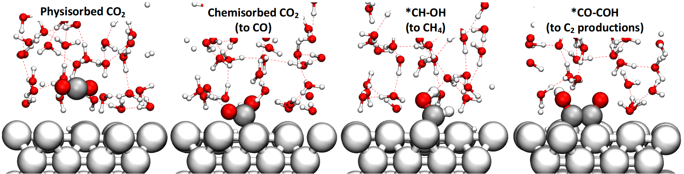
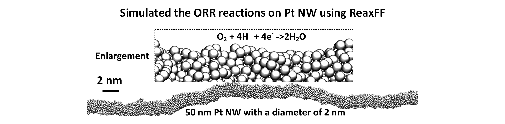

  
<strong>We are working on:我们的研究方向：</strong>

  <a href="#electrochemical-reaction">Electrochemical Reaction电化学反应</a>
  <a href="#battery-interface">Battery Interface/Interphase电池界面/中间相</a>
  <a href="#advanced-methods">Advanced Methods先进模拟方法</a>

  <h2 id="electrochemical-reaction">1. Electrochemical Reaction1. 电化学反应</h2>
  
<a href="#co2rr">Carbon Dioxide Reduction二氧化碳还原</a> | <a href="#orr">Oxygen Reduction Reaction氧还原反应</a>

  <h3 id="co2rr">1.1 Carbon Dioxide Reduction1.1 二氧化碳还原</h3>
  

  
<strong>A critical step towards rational design of new catalysts that achieve selective and efficient reduction of carbon dioxide to specific hydrocarbons and oxygenates is to determine the detailed reaction mechanism including kinetics and product selectivity as a function of pH and applied potential for known systems. To accomplish this we apply ab initio molecular dynamics free energy calculation for the water/Cu system with explicit solvent to determine the kinetics and pathways for major products (ethylene and methane) and minor products (ethanol, glyoxal, glycoladehyde, ethylene glycol, acetaldehyde, ethane and methanol).合理设计能够将二氧化碳高选择性、高效率地还原为特定碳氢化合物和含氧化合物的新型催化剂，其关键一步是确定已知体系的详细反应机理，包括动力学以及产物选择性随 pH 和外加电位的变化规律。为此，我们采用显式溶剂的从头算分子动力学自由能计算方法研究水/Cu体系，确定主要产物（乙烯和甲烷）与次要产物（乙醇、乙二醛、羟基乙醛、乙二醇、乙醛、乙烷和甲醇）的动力学过程与反应路径。</strong>

  
<strong>Related publications:相关论文：</strong>

  <a href="http://dx.doi.org/doi:10.1021/acs.jpclett.8b00959">Surface Ligand Promotion of CO2 Reduction</a>
  <a href="http://dx.doi.org/10.1021/jacs.7b09251">Ultrahigh Mass Activity for CO2 Reduction</a>
  <a href="http://dx.doi.org/10.1021/jacs.7b03300">Nature of Active Sites for CO Reduction on Cu Nanoparticles</a>
  <a href="http://dx.doi.org/10.1021/acs.jpclett.7b01335">Predicted Structures of Active Sites for CO Reduction</a>
  <a href="http://dx.doi.org/10.1073/pnas.1612106114">Full Atomistic Reaction Mechanism for CO Reduction on Cu(100)</a>
  <a href="http://dx.doi.org/10.1021/jacs.6b08534">Reaction Mechanisms for Electrochemical Reduction of CO2</a>
  <a href="http://dx.doi.org/10.1021/acs.jpclett.5b02247">Free-Energy Barriers for CO Reduction on Cu(100)</a>
  
<a href="#top" style="font-size: 0.85em; border: none; padding: 0;">↑ back to top↑ 返回顶部</a>

  <h3 id="orr">1.2 Oxygen Reduction Reaction1.2 氧还原反应</h3>
  

  
<strong>The sluggish Oxygen Reduction Reaction (ORR) is a major impediment to economical use of fuel cells in transportation. However, the reaction mechanism of ORR is still far from clear. Here, we explored the full ORR reaction mechanism for Pt(111) based on ab initio molecular dynamics free energy calculations including explicit water.缓慢的氧还原反应（ORR）是燃料电池在交通领域经济性应用的主要瓶颈之一。然而，ORR 的反应机理至今仍远未明晰。我们基于包含显式水的从头算分子动力学自由能计算，系统研究了 Pt(111) 表面 ORR 的完整反应机理。</strong>

  
<strong>Related publications:相关论文：</strong>

  <a href="http://dx.doi.org/10.1039/C6CP08055C">Mechanism and Kinetics of Electrocatalytic ORR</a>
  <a href="http://dx.doi.org/10.1126/science.aaf9050">Ultrafine Jagged Pt Nanowires for ORR</a>
  
<a href="#top" style="font-size: 0.85em; border: none; padding: 0;">↑ back to top↑ 返回顶部</a>

  <h2 id="battery-interface">2. Battery Interface/Interphase2. 电池界面/中间相</h2>
  <a href="#solid">Solid Electrolyte Interface固体电解质界面</a>

  <h3 id="solid">2.1 Solid Electrolyte Interface2.1 固体电解质界面</h3>
  
<a href="#top" style="font-size: 0.85em; border: none; padding: 0;">↑ back to top↑ 返回顶部</a>

  <h2 id="advanced-methods">3. Advanced Methods3. 先进模拟方法</h2>
  <a href="#amd">Accelerated Molecular Dynamics加速分子动力学</a>

  <h3 id="amd">3.1 Accelerated Molecular Dynamics3.1 加速分子动力学</h3>
  
<strong>We develop the methodology for dramatically accelerating the ReaxFF reactive force field based reactive molecular dynamics simulations through use of the bond boost concept, which we validate for describing hydrogen combustion.我们发展了基于键增强（bond boost）概念大幅加速 ReaxFF 反应力场反应分子动力学模拟的方法，并以氢气燃烧体系为例对该方法进行了验证。</strong>

  
<strong>Related publications:相关论文：</strong>

  <a href="http://dx.doi.org/10.1021/ja5037258">Adaptive Accelerated ReaxFF Reactive Dynamics</a>
  
<a href="#top" style="font-size: 0.85em; border: none; padding: 0;">↑ back to top↑ 返回顶部</a>

